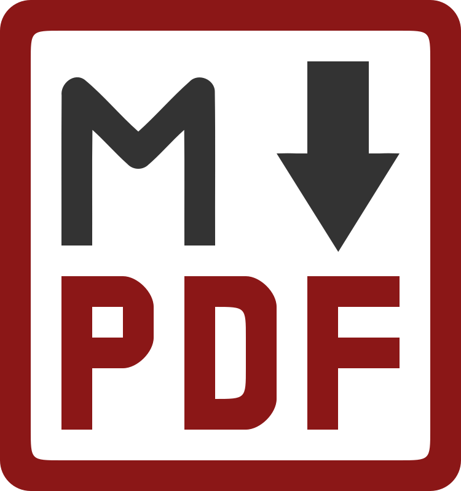
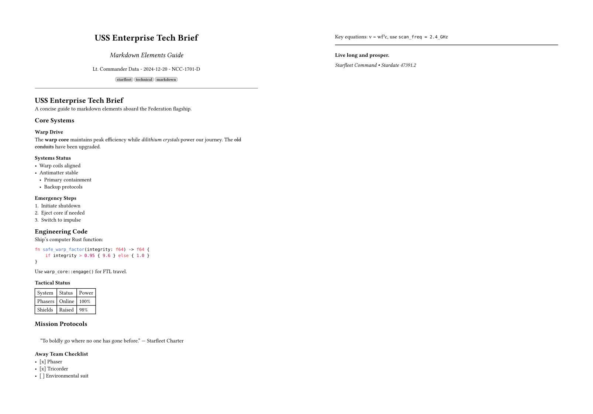
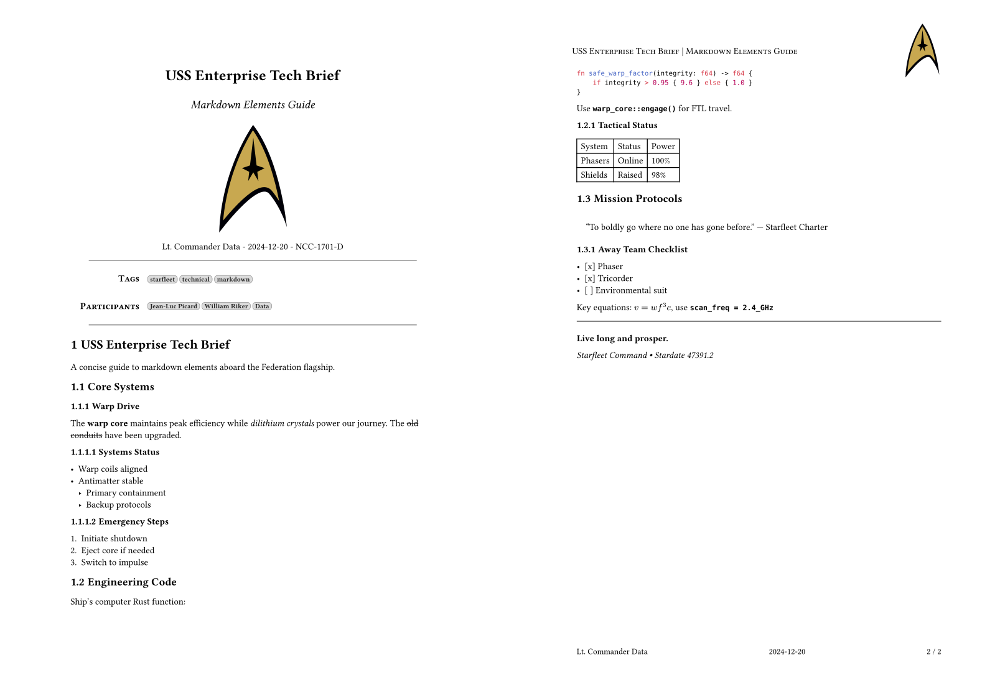
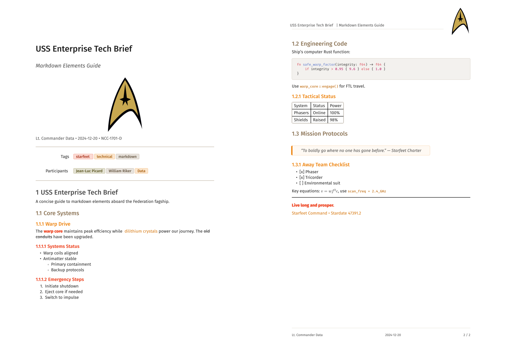
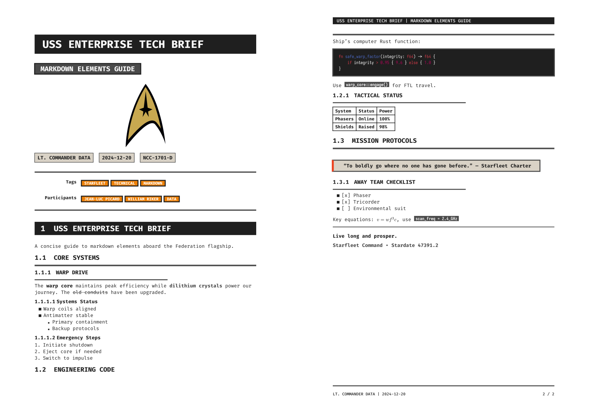
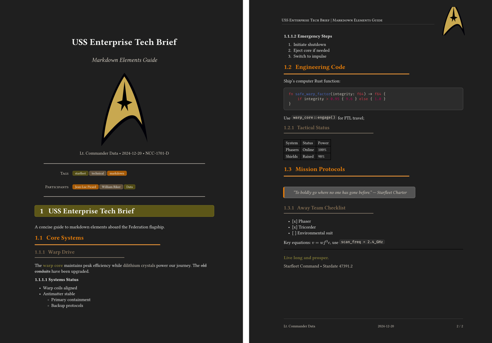

 

[](https://github.com/sponsors/tschinz)


<div align="center">
  
</div>

# md-pdf

A fast, lightweight command-line tool that converts Markdown files to professional PDF documents using [Typst](https://typst.app).

## Features

- 🚀 **Fast conversion** powered by a built-in Typst compiler
- 🎨 **Professional output** with built-in templates
- ⚙️ **Zero configuration** - works out of the box
- 👀 **Watch mode** for live preview
- 📂 **Auto-open** generated PDFs
- 🔗 **Link validation** checks external URLs
- 📝 **Rich metadata** support via YAML front matter
- 🧩 **[OKF](https://okf.md/spec/) front matter compatibility** with backwards-compatible aliases
- 🖼️ **Sizable & alignable images** via the HTML `` tag

## Installation

md-pdf is a single self-contained binary: the [Typst](https://typst.app) compiler is built in, so there is nothing else to install. Typst packages used by the templates (e.g. `@preview/cmarker`) are downloaded automatically on first use and cached.

### Fonts (optional)

Templates fall back to the bundled default fonts. For their intended look, install [Fira Sans and Fira Mono](https://github.com/mozilla/Fira) and [Iosevka](https://typeof.net/Iosevka/).

### Install md-pdf

```bash
# From source
cargo install --locked --git https://github.com/tschinz/md-pdf

# Or build locally
git clone https://github.com/tschinz/md-pdf
cd md-pdf && cargo install --locked --path .

# from crates.io
cargo install --locked md-pdf
```

`--locked` builds with the exact dependency versions md-pdf was tested with (from its `Cargo.lock`) instead of resolving newer ones.

## Quick Start

```bash
# Convert markdown to PDF
md-pdf document.md

# Convert and open PDF automatically
md-pdf document.md --open

# Watch for changes (live preview)
md-pdf --watch document.md

# Watch for changes and open PDF after each rebuild
md-pdf --watch document.md --open

# Check links before conversion
md-pdf --check-links document.md

# Use specific template
md-pdf document.md -t none
md-pdf document.md -t simple
md-pdf document.md -t playful
md-pdf document.md -t brutalist
md-pdf document.md -t darko
```

## Usage

```
Convert markdown files to PDF using typst with templating

Usage: md-pdf [OPTIONS] [INPUT]

Arguments:
  [INPUT]  Path to the input Markdown file

Options:
  -o, --output <OUTPUT>      Path to the output PDF file
  -t, --template <TEMPLATE>  Template to use for PDF generation [default: none]
  -w, --watch                Watch the input file for changes and rebuild automatically
      --check-links          Check all links in the markdown file and display warnings for unreachable links
      --list-templates       List all available templates
      --create-config        Create default configuration file
      --show-config          Show configuration file locations and settings
      --open                 Open the generated PDF file after creation
      --refresh-templates    Refresh templates in the config directory with the latest embedded versions
  -h, --help                 Print help
  -V, --version              Print version
```

## Templates

- `none` - Minimal styling (default)
  
- `simple` - Professional with headers/footers
  
- `playful` - colorful inspired by Dieter Rams
  
- `brutalist` - Raw, bold, stark design with high contrast
  
- `darko` - May the dark side be with you
  
- You can add you own templates

## Front Matter

Add metadata to your markdown, all elements are optional:

```yaml
---
type: "report"
title: "My Document"
description: "One-line description"
logo: "path/to/logo.png"
author: "Your Name"
timestamp: "2026-01-23"
version: "0.0.1"
status: "draft"
resource: "https://example.com/source"
language: "en"
toc: true
tags: ["tag1", "tag2"]
participants: ["Participant1", "Participant2"]
template: "simple"
---
# Content starts here
```

### OKF-style YAML compatibility

md-pdf front matter is compatible with [OKF (Open Knowledge Format)](https://okf.md/spec/) style YAML. OKF's fields map directly onto md-pdf's, and unknown keys are preserved and passed through to the template (so OKF trust fields such as `sources`, `generated`, `verified`, and `stale_after` are kept as-is).

The canonical field names match OKF. For backwards compatibility, the previous md-pdf names are still accepted as aliases:

| Field (canonical) | Accepted alias | Notes |
|---|---|---|
| `type` | — | Document type (e.g. `report`, `letter`), shown as a label above the title |
| `title` | — | Document title |
| `description` | `subtitle` | One-line description / subtitle |
| `timestamp` | `date` | `YYYY-MM-DD`, `YYYYMMDD`/`YYYY` number, or ISO 8601 (`2026-09-21T14:30:00Z`, rendered as its date) |
| `tags` | `keywords` | List of tags |
| `status` | — | Lifecycle state (e.g. `draft`, `review`, `final`) |
| `resource` | — | A URI the document describes |
| `language` | `lang` | Document language |

Both spellings work — for example, `description:` and `subtitle:` are equivalent:

```yaml
---
type: "report"
title: "Quarterly Results"
description: "Q3 revenue and outlook"     # or: subtitle:
author: "Your Name"
timestamp: "2026-09-21T14:30:00Z"         # or: date:
tags: ["finance", "q3"]                   # or: keywords:
status: "draft"
language: "en"                            # or: lang:
---
# Content starts here
```

## Images

Standard Markdown image syntax renders images at their natural size:

```md

```

Markdown itself has no syntax for sizing images (Pandoc-style attributes such as `{width="40%"}` are **not** supported by the underlying parser). To resize or align an image, use the HTML `` tag instead:

```md
<!-- 40% of the text width, centered -->


<!-- fixed height, left aligned -->

```

- `width` / `height` accept a percentage (`40%`, `40.0%`) or an absolute value in
  points (`120`).
- `align` accepts `left`, `center`, or `right`.
- Paths containing spaces must be wrapped in `<>` in Markdown syntax:
  ``.

For full control you can also inject raw Typst via an HTML comment:

```md
<!--raw-typst #align(center)[#image("path/to/image.svg", width: 40%)] -->
```

## Configuration

Auto-created at `~/.config/md-pdf/config.ron` on first run. Customize defaults:

```rust
(
    templates_dir: Some("/Users/username/.config/md-pdf/templates"),
    default_template: Some("simple"),
    default_author: Some("Your Name"),
    default_language: Some("en"),
    default_toc: Some(true),
)
```

## Examples

See [`examples/comprehensive-guide.md`](examples/comprehensive-guide.md) for full documentation and feature demonstrations.

```
md-pdf example/comprehensive-guide.md
```

> Rustdoc AI generated
